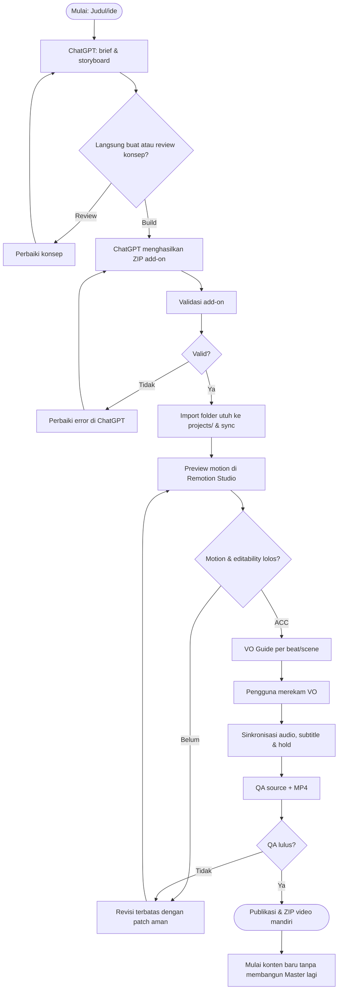

# User Flow — ChatGPT × MotionGraphic Studio

**Tujuan:** hanya satu jalan yang jelas dari ide sampai hasil, dengan opsi pulih ketika muncul error. Ini adalah panduan workflow dan CLI; bukan editor grafis kedua.

## 8 tahap produksi

| Tahap | Tujuan pengguna | Aksi tunggal yang jelas | Kondisi sukses / pesan kesalahan |
|---|---|---|---|
| 01 Entry | Mulai dari judul | `npm run flow` → buat brief ChatGPT | File `exports/briefs/<slug>-chatgpt.md` jadi; bila judul kosong, tidak mengubah data |
| 02 Goal | ChatGPT membuat isi | Bagikan brief ke Project ChatGPT Motion-Graphic; minta add-on lengkap | ZIP add-on, bukan ZIP Master; tetap sesuai kontrak |
| 03 Decision | Periksa kompatibilitas | `npm run addon:validate -- <folder> --strict --syntax` | FAIL berarti perbaiki sumber terlebih dahulu |
| 04 Navigation | Import dan preview | `npm run addfolder -- <folder>` lalu `npm run dev` | Komposisi tampil tanpa menimpa project lain |
| 05 Success gate | Review hasil | Drag/ubah teks/timing → Save → reload → render 1 frame | Ketidaksesuaian = revisi terbatas; jangan klaim 100% editable sebelum lulus |
| 06 VO | Rekam setelah ACC | Buka `<ID>VOGuide`, baca teks lalu rekam | Panduan hanya untuk rekaman, tidak memenuhi video final |
| 07 QA | Menjadi video final | `npm run render` lalu `npm run qa:render -- <mp4> --src projects/<slug>` | Tinjau contact sheet, audio, safe zone dan status QA |
| 08 Retention | Kembali lagi nanti | `npm run zip -- --all` untuk arsip per video; `npm run zip -- --studio` untuk Master Engine Only | Project tetap di PC sampai diarsipkan/dihapus sengaja |

## Prinsip UX dari referensi user flow

- **Entry point:** pengguna dapat memulai dari judul saja; jangan minta rekaman suara.
- **Primary goal:** satu add-on Remotion editable yang bisa diuji, bukan hanya MP4.
- **Decision points:** tombol/aksi yang wajar `review`, `revisi`, `ACC`, `rekam`, `QA`, bukan pilihan teknis yang membingungkan.
- **Clear directions:** satu langkah dan instruksi yang relevan ketika ada error. Error import bukan alasan menghapus project.
- **Success feedback:** keberhasilan hanya ditampilkan setelah file ada/validator lulus; status GUI diuji manual.
- **Error handling:** kembalikan source yang gagal ke ChatGPT; revisi patch dicek dengan `--dry-run`.
- **Retention:** simpan ZIP tiap video terpisah dan bagikan Master Engine Only; jangan membawa puluhan video di paket engine.

## Dua jalur penting

**Video baru:** `npm run flow -- --new "Judul"` → salin brief ke ChatGPT → terima add-on → validate/import → preview.

**Revisi video:** identifikasi slug dan scene yang diubah → berikan source relevan/preview ke ChatGPT → minta patch file tertentu → `npm run addon:patch -- <ZIP> --dry-run` → terapkan jika tidak konflik.

> Tidak ada integrasi otomatis antara terminal Windows dan ChatGPT. Brief disimpan untuk disalin secara manual. `npm run flow` tidak mengunggah data, menjalankan render, atau mengubah project yang sudah ada.
